  

  

  
  
  
  <!-- YouTube: descomentar quando o canal existir
  
  -->

🇧🇷 <a href="#pt">português</a> · 🇺🇸 <a href="#en">english</a>

## Oi, eu sou o Bruno 👋

Desenvolvedor brasileiro. No trabalho eu uso IA de verdade, todo dia: agentes que revisam PR, voz clonada rodando na minha
placa de vídeo, vídeos escritos em código, reuniões que viram ata sozinhas. Em vez de falar sobre isso, eu **mostro
a coisa rodando** e deixo o código aqui, grátis.

- 🎬 Cada vídeo no [Instagram](https://instagram.com/brunodelatea) vira **1 repositório público** neste perfil.
- 📖 Todo repo tem **README em português e inglês** e um **`AGENTS.md`** para a sua IA (Claude Code, Codex, Cursor…) instalar e adaptar sozinha.
- 🔓 Licença MIT. Tudo grátis no GitHub · código aberto.

<b>🇺🇸 English</b>

 

Brazilian software developer. I use AI for real at work, every day: agents that review PRs, a voice clone running on my
own GPU, videos written as code, meetings that turn into minutes on their own. Instead of talking about it, I **show it
running** and leave the code here, free.

- 🎬 Every video on [Instagram](https://instagram.com/brunodelatea) becomes **one public repository** on this profile.
- 📖 Every repo ships a **README in Portuguese and English** plus an **`AGENTS.md`** so your AI (Claude Code, Codex, Cursor…) can install and adapt it by itself.
- 🔓 MIT licensed. Everything free on GitHub · open source.

## 🎁 Cada vídeo = 1 repositório grátis

Comenta a palavra no vídeo e o link chega. Ou pega direto aqui. A tabela se atualiza sozinha quando um repo fica público.

<!-- REPOS:START -->
**0 de 7 no ar** · atualizado automaticamente todo dia

| Repositório | O que é | Comenta no vídeo | Status |
|---|---|:---:|:---:|
| **ai-code-review-bot** | Agente que revisa pull requests sozinho: lê o diff, aplica regras de qualidade e segurança, comenta e decide aprovar ou devolver. | `REPO` | 🔒 em breve |
| **claude-code-skills** | As skills do Claude Code que eu uso todo dia (automação, revisão, operação), prontas para instalar em qualquer projeto. | `SKILLS` | 🔒 em breve |
| **remotion-reels-pipeline** | Pipeline que escreve e renderiza Reels em código (Remotion): cenas, legenda karaokê, identidade visual e mixagem de áudio. | `REELS` | 🔒 em breve |
| **local-voice-clone** | Clone de voz 100% local numa RTX 3060 (Qwen3-TTS), da gravação de referência até a narração final. | `VOZ` | 🔒 em breve |
| **ptbr-tts-phonetics** | Camada de fonética pt-BR para TTS: detecta palavras em inglês e aplica a pronúncia abrasileirada automaticamente. | `FONÉTICA` | 🔒 em breve |
| **ai-talking-head-editor** | Editor automático de vídeo falado: transcreve, corta silêncio e gaguejo, corrige a fala com voz clonada, reenquadra pro vertical e queima legenda karaokê. | `EDIT` | 🔒 em breve |
| **auto-meeting-notes** | Transcreve reuniões (quem falou, quando), gera a ata sozinho e avisa por push quando termina. | `ATA` | 🔒 em breve |
<!-- REPOS:END -->

## 🧰 O que eu uso de verdade

  
  
  
  
  
  
  
  
  
  

Mais um pouco de bastidor: Whisper e Qwen3-TTS numa RTX 3060 (voz e transcrição 100% locais), systemd e muito terminal.

## 📈 Atividade

  
  

  <picture>
    <source media="(prefers-color-scheme: dark)" srcset="https://raw.githubusercontent.com/brunodelatea/brunodelatea/output/snake-dark.svg">
    <source media="(prefers-color-scheme: light)" srcset="https://raw.githubusercontent.com/brunodelatea/brunodelatea/output/snake-light.svg">
    
  </picture>

  Tá tudo no GitHub. De graça. Código aberto. · <a href="#topo">↑ topo</a>

